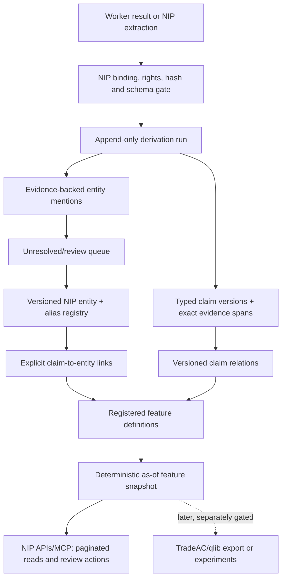

# NIP Single-Authority Architecture — Phase 5 Design Proposal

**Status:** Phase 5 is implemented and published to `main` as `e5a75b9`. Serial Rust tests, targeted rustfmt checks, and diff hygiene checks passed; full Clippy is unverified because the native DuckDB archive build exhausted sandbox disk. The user chose: preserve old data; skip legacy migration/conversion. Migration 23 is additive and introduces NIP-owned contract-v2 derivations, review/resolution/link history, and descriptive feature snapshots; no legacy conversion, backfill, reconciliation, rewrite, or deletion was performed. Phase 4 is published at `5061d1c`.

**Governing context:** [Storage map](STORAGE_MAP.md), [single-authority architecture](NIP_SINGLE_AUTHORITY_ARCHITECTURE.md), [Phase 4 handoff](NIP_PHASE4_HANDOFF.md), the draft [entity/claims/features research](65-entity-claims-features-signal-research.md), the [agent-native journey plan](69-agent-native-modes-and-full-journey-plan.md), and the [NIP testing plan](57-narrative-intelligence-testing-plan.md).

## 1. Recommendation

Make Phase 5 the first **canonical interpretation layer** on top of Phase 4's immutable NIP event/transcript evidence. NIP should accept evidence-backed claim and entity-mention derivations, maintain its own reviewable entity registry, record claim revisions and relationships without overwriting history, and produce a small set of registered, deterministic, point-in-time entity features.

Keep the physical model unchanged: NIP's transactional records remain in `NIP_LAKE_DIR/_nip/nip.duckdb`; fina-scraper's Parquet/SQLite/YAML remain worker/legacy data and are not copied into DuckDB; `TAC_LAKE_DIR` remains TradeAC-owned. Phase 5 should establish one logical NIP authority, not claim a one-store architecture.

The initial feature path should derive descriptive values in NIP from NIP-accepted claims and reviewed entity links. Continue rejecting unregistered or under-specified worker feature values. Add worker-computed values only under a future/explicit contract version that names the entity, registered definition/version, units, formula provenance, and point-in-time inputs. Phase 5 is not a trading-signal validation or recommendation phase.

## 2. Current baseline and design implications

The current domain contract already has `AcquisitionClaim`, `AcquisitionEntity`, and `AcquisitionFeatureValue`, and validates bounded confidence values, unique worker IDs, extraction provenance, and exact Unicode-scalar evidence spans. Phase 4's service/store path deliberately rejects claims, entities, and features. The acquisition batch is version 1 and strict about unknown fields. Important gaps for the next phase are:

- Claims carry a subject/predicate/object triplet and one evidence span, but no explicit entity references, claim type, polarity/horizon, or claim-validity interval. A producer entity list cannot be safely attached to a claim by matching strings or overlapping quotes.
- Entity `canonical_id` and `ticker` are producer fields, not NIP-resolved identities. There is no canonical `nip_entities` registry or reviewed alias-resolution history.
- `AcquisitionFeatureValue` has an arbitrary JSON value and time/provenance fields, but no target entity, value/unit contract, registered-definition version, or formula/input hash. It is not safe to persist as an entity feature.
- `nip_claims` and `nip_claim_evidence` already support retained-event claims and exact quote offsets. However, `Store::store_claim` updates an existing `claim_id` on conflict. Phase 5 must not reuse that mutable path for append-only worker derivations.
- `nip_agent_entity_candidates` and `nip_agent_claim_annotations` are external-agent analysis records, not a canonical entity catalog or review decision. Keep their existing meaning and do not auto-promote their rows.
- The current weekly narrative signal snapshot is not an entity feature store. It must not be relabeled as a resolved-entity Radar or an investment signal.

The Phase 4 item/event identity remains authoritative: an accepted event body/hash is immutable under that worker identity. New extraction of unchanged evidence is a new derivation, not a changed event. A changed event body continues to be rejected by the Phase 4 collision policy unless a separately specified NIP event-revision workflow is approved.

## 3. Target architecture

The worker may propose claims, mention candidates, and (under a later compatible contract) feature values. It never registers NIP entities/features, sets NIP review state, or writes canonical tables directly. NIP validates and commits each accepted derivation. Product-facing reads are NIP reads; any future TradeAC integration is a typed, read-only/export boundary, not a write into its market lake.

## 4. Logical data model

Names below are proposals to be reconciled with DuckDB's supported migration operations before coding. They describe one NIP-owned model; they are not a request to create duplicate catalogs.

| Record | Purpose and core invariants |
| --- | --- |
| `nip_derivation_runs` | NIP-known run for annotations against one immutable event/content hash. Record producer, worker run/profile when applicable, model/version, contract/schema/prompt version, start/completion, NIP `known_at`, output hash, status, and coverage. Distinct from Phase 4 `nip_acquisition_runs`, which records acquisition lineage. |
| `nip_claim_annotations` (or an equivalently named one-to-one typed extension) | Adds the worker's structured subject/predicate/object and optional typed fields to an immutable `nip_claims.claim_id`: worker-native claim ID and namespace, derivation run, claim type, polarity/certainty/horizon/magnitude where supplied, attribution, validity interval, source payload kind/hash, and separate NIP review state. Missing values remain missing; never synthesize unsupported semantics. |
| `nip_claim_evidence` | Reuse the existing event-linked evidence model. Add a nullable payload discriminator/hash for new worker evidence so the validator can distinguish `item_content` from the separate acquisition transcript. Validate quote and Unicode-scalar offsets against that exact immutable text. Legacy rows remain readable and unlabelled where payload kind is unknown. The current worker contract's one-span-per-claim scope fits the existing `(claim_id,event_id)` key; a multi-span contract would need an explicit later schema change. |
| `nip_entity_mentions` | One evidence-backed mention per mention ID, with event/content hash, source, run, worker namespace/ID, surface form/type, quote and span, extraction provenance, and `known_at`. A mention may be unresolved. Mention creation does not create a global entity. |
| `nip_entities`, `nip_entity_aliases`, `nip_entity_resolution_history` | NIP-owned stable entity identity, reviewed/source-scoped aliases, and append-only resolution/merge/split decisions. Aliases and mappings carry resolver/reviewer and effective/known-time metadata. Ambiguous or unsupported matches remain unresolved. |
| `nip_claim_entity_links` | Explicit, role-bearing links from a claim version to one or more mention/entity IDs (for example subject, object, speaker). Never infer these links from coincident text. A worker reference must resolve within that item's namespaced entity list. |
| `nip_claim_relations` | Versioned, provenance-bearing `restates`, `supports`, `contradicts`, `supersedes`, or duplicate-candidate edges. The edge is a derivation/review result, not a destructive merge; it records the run/reviewer and `known_at`. |
| `nip_entity_instruments` (narrow and reviewed) | Effective-dated link between a NIP company/security entity and a TradeAC instrument identity, with venue, validity, known time, evidence, and review status. A ticker string alone is not a global security ID. Do not import or write the TradeAC market lake. |
| `nip_feature_definitions` | Append-only, NIP-registered key/version with entity grain, numeric type/unit, formula/code version, window, eligible input/review policy, minimum coverage, missing-value rules, and status. A worker cannot add or redefine a key. |
| `nip_feature_runs`, `nip_entity_feature_values` | Reproducible snapshot/run and values keyed by feature-definition version, entity, window, and `as_of`; include `known_at`, input-manifest hash, formula version, sample/coverage counts, availability mode, and quality flags. Missing/insufficient is explicit, never silently zero-filled. |

### Canonical claim and entity policy

Treat each `nip_claims` row created by the Phase 5 worker path as one immutable claim version with a new NIP `claim_id`; attach typed data in the companion row and exact evidence in the existing evidence table. Re-extraction creates another claim version and a relation to the earlier version. Do not update the earlier claim row in place and do not use the existing `store_claim` upsert for this path. Existing legacy claims remain readable as untyped/legacy; no bulk backfill is required.

Separate **producer extraction status** from **NIP acceptance/review state**. Preserve the worker's `ExtractionTier` and `ClaimReviewStatus` verbatim as producer provenance. Add a distinct NIP review state such as `pending`, `accepted`, `rejected`, or `correction_requested`. `llm_verified` from a producer is not NIP human approval and must not silently make a claim investment-grade or feature-eligible.

For entity resolution, persist every valid mention first. Resolve only by a unique NIP-approved exact ticker/alias or an explicit reviewer decision. A worker's `canonical_id`, ticker, or LLM suggestion is a candidate, not authority. Entity merges/splits and alias corrections are append-only; prior claim versions keep their original mention and resolution history. Company, security/instrument, person, product, theme, and index are distinct entity kinds.

### Claim identity, replay, and overlapping sources

- Exact replay of the same derivation output for the same namespaced worker claim ID and event is a no-op; the run may still be recorded if it represents a distinct acquisition attempt.
- Reuse of the same derivation identity with different content is rejected. Re-annotation requires a new derivation/schema/model/prompt version and creates a new immutable claim version linked to its predecessor.
- A changed event body is not a claim revision; it remains subject to the Phase 4 event-identity collision rule.
- Repeated windows or duplicate wording from the **same source/event** must not multiply feature counts. Preserve evidence/claim history, but deduplicate the derived count at `(source/event, normalized-fact key, feature window)` or mark a reviewable duplicate relation.
- Similar claims from **different sources** remain distinct evidence-bearing observations; never merge their IDs just because their wording or novelty key matches. Expose `distinct_source_count` separately from claim count. Do not call this “independent corroboration” unless a reviewed source-family/syndication map establishes independence. `supports`/`contradicts` relations require explicit provenance and can later inform descriptive features.
- A semantic-similarity result is a candidate relation, not a deterministic identity key. Similarity alone must not collapse claims or create a ticker mapping.

### Graph scale and bounded extraction

Fifty claims from a long episode are not a storage-capacity problem if claims, spans, mentions, and edges are normalized and indexed; they are a quality, duplication, and read-surface problem. Do not store duplicate copies of transcript quotes on graph nodes/edges or return an unbounded full graph by default. Claim/mention lists and graph edges should be filtered and paginated by event, entity, source, time window, and `as_of`; fetch exact quote text on claim detail. Entity-feature snapshots should aggregate at the requested entity/window instead of materializing a giant cross-product.

Bound producer output with an explicit, versioned extraction policy. The existing research draft suggests a low per-window/per-episode cap (for example, four per window and twenty per episode), but these are proposed starting values, not correctness guarantees; confirm them against a stratified human-reviewed precision sample. Preserve output/coverage metadata so a cap or partial run is visible. Same-source duplicate candidates may be grouped using a deterministic key derived from typed fields, but grouping is only a projection: it must not delete claims or establish identity, and uncertain cases remain separate with a quality flag.

### Point-in-time semantics

Keep the time concepts separate: source `published_at`, event/item capture and ingestion, claim/mention valid time, derivation completion, and NIP `known_at`. For a new derivation, its claim/mention `known_at` is the time NIP first commits that derivation (not merely the old event's publication or ingestion time). Thus a re-extraction performed later cannot leak into a feature snapshot whose `as_of` predates that derivation. Source validity remains separately represented by `valid_from`/`valid_to`; absent validity is unknown, not guessed.

Feature reads at `as_of` include only definitions, resolutions, claims, and relations known by that cutoff, and only source facts valid for the requested window. Preserve `live` versus `reconstructed`; reconstructed evidence must not be passed off as live. Every snapshot records exact `as_of`, window, definition/formula versions, input hash, run ID, coverage, and quality flags.

## 5. Acquisition contract and write path

Do not silently change the strict version-1 `AcquisitionBatch` interpretation. Keep version 1 compatible for item/transcript and evidence-only claims. Add a versioned extension (recommended `contract_version: 2`) for richer claim/entity linkage:

- Because the current canonical `ClaimRecord` requires `claim_text` while worker v1 supplies only a structured triplet, v2 should carry display claim text labeled as a producer paraphrase. For v1 compatibility, any deterministic `subject — predicate — object` rendering must be marked as a rendering, never treated as a source quote. Exact quote and offsets remain separate evidence.
- Claims add explicit entity references (namespaced `worker_entity_id` plus role), optional closed-vocabulary claim type/polarity/certainty/horizon/magnitude/attribution and optional claim-validity bounds. No field is inferred from free text.
- Entity records remain mention/candidate payloads. Their worker IDs are unique within the item; external canonical IDs and tickers are preserved as producer hints only.
- An explicit per-item derivation manifest reports whether claim/entity extraction was `complete`, `partial`, `not_requested`, or `failed`, plus covered windows/counts and output hash. An empty claim list alone must not be interpreted as a successful zero-claim analysis.
- A feature result names `worker_entity_id` or NIP entity reference, registered feature key **and definition version**, typed value/unit, formula version, input/content hash, `as_of`, valid interval, availability, and provenance. V1 arbitrary JSON feature values remain rejected.

`ingest_acquisition_item` may accept the first validated claim/mention derivation in the same transaction as the item/event/transcript, retaining Phase 4's one-item scope, rights/binding checks, exact-replay behavior, and all-or-nothing rollback. Provide a separate derivation-only operation for later re-extraction of an already retained event. It must require the same current binding and exact immutable event content hash; it records new derivation lineage and cannot mutate the event. If any claim, reference, or span in one submitted derivation is invalid, reject the whole derivation rather than partially importing it.

No generic worker tool-call RPC is implied by this plan. The supervisor's lifecycle-only boundary remains until a separately tested request/result adapter is approved. Do not reuse `import_local_event` unchanged.

## 6. Feature scope for the first release

Start with a small, versioned set of **descriptive** features computed by NIP from canonical, eligible claim/entity records. Candidate MVP keys are:

- `nip.claim_observation_count` — unique source-event/fact observations in the window;
- `nip.distinct_source_count` — NIP sources represented, not a claim of source independence;
- `nip.polarity_counts.{positive,neutral,negative}` or a defined numeric net polarity only when the producer supplies validated explicit polarity;
- `nip.unresolved_mention_rate` and `nip.coverage_status` — explicit quality/coverage, not a sentiment score.

The precise keys and formulas need review before implementation. Do not launch centrality, influence, novelty, source weights, or predictive scores in this phase unless a labelled review set and explicit formula decision justify them. These values describe the retained corpus; they are not investment advice or validated alpha. Require NIP-accepted claims for the default research snapshot, or surface machine-only rows in a separate, clearly flagged channel. Never silently upgrade producer tier/review.

Feature-definition registration is explicit and NIP-owned. For the initial registry, constrain values to numeric features with a declared unit; use a typed numeric column, with separate status/quality flags for unavailable or insufficient observations. Avoid an untyped JSON feature warehouse. A future `export_feature_matrix`/qlib experiment handoff should be a separate, reproducible integration to TradeAC, not a Phase 5 write into `TAC_LAKE_DIR`.

## 7. Implementation slices and exit gates

Phase 5 implemented the bounded contract and persistence surface described below. The contract, migration, store/service wrappers, and MCP tools are published on `main` at `e5a75b9`. Serial Rust tests, targeted source formatting, and diff hygiene checks passed; full Clippy is unverified because the native DuckDB archive build exhausted sandbox disk.

### P5.0 — Contract and policy freeze

**Implemented:** Contract v1 remains backward compatible for evidence-backed unlinked claims/mentions. Contract v2 adds a derivation manifest, typed optional claim fields, and explicit role-bearing worker entity references. Validation keeps exact Unicode-scalar evidence spans, rejects duplicate/missing references, and does not infer polarity, certainty, entity identity, or ticker mapping. Claim fact keys normalize by trimming, lowercasing, and collapsing whitespace.

**Gate:** domain fixtures cover v1 serialization compatibility and v2 validation/manifest/reference rules.

### P5.1 — Append-only derivations and evidence

**Implemented:** Additive migration 23 adds derivation-run fingerprints, typed claim annotations, evidence payload metadata, review history, and the supporting entity/relation/feature tables. Initial ingestion and later derivation-only reprocessing persist transactionally; NIP-generated `known_at` is not accepted from the producer. Identical run/output replay is a no-op; changed producer/manifest/output under the same derivation identity conflicts. One late constraint failure proves transaction rollback.

**Gate:** schema-22 fixture rows remain readable with nullable new evidence metadata; no claims/entity promotion or other legacy transformation occurs. Exact replay, conflict, timestamp, evidence, and rollback tests pass.

### P5.2 — Evidence-backed mentions and explicit resolution

**Implemented:** Persist unresolved evidence-backed mentions, role-bearing claim-to-mention links, reviewer-created canonical entities, and append-only resolve/reject history. Worker canonical IDs and tickers remain hints; no automatic matching or promotion occurs.

**Deferred intentionally:** Although migration 23 reserves an alias table, this release does not expose alias authoring/matching, merge/split workflows, or a reviewed TradeAC-instrument mapping API. Resolution is explicit by mention ID and selected NIP entity. These require separate identity and effective-time policies.

**Gate:** every linked mention reads back to its derivation and exact retained quote; reviewer and reason are auditable; resolution known-at is generated in NIP and feature eligibility respects its cutoff.

### P5.3 — Claim review, relations, and traceable reads

**Implemented:** Append-only NIP claim review history and provenance-bearing `restates`, `supports`, `contradicts`, `supersedes`, or duplicate-candidate relations; paginated annotation, review-history, relation, mention, link, and resolution-history reads. Producer extraction/review state remains separate from NIP review.

**Gate:** prior decisions and claim versions remain readable; unsupported/invalid relationships are rejected; no string/text-based entity link is inferred.

### P5.4 — Registered descriptive feature snapshots

**Implemented:** Migration 23 seeds five numeric descriptive definitions. A deterministic snapshot builder includes only claims and definitions known by `as_of`, accepted under the latest review then known, valid in the requested half-open window, and linked to the entity through the latest resolution decision then known. Same-source/event normalized facts deduplicate for observation counts; source counts are not described as independent corroboration. Input and definition-set hashes, availability, sample counts, and quality flags are persisted; insufficient values are null, and reconstructed evidence is labelled.

**Gate:** regression fixtures independently place `as_of` before/after claim review and entity resolution, verify same-source deduplication, verify future definitions are excluded, and confirm stable snapshot identity on replay.

### Phase 5 exit

The exit check was completed with Rust 1.100 from `~/.rustup`: the serial domain/store/engine suite passed, including MCP target tests, fresh-schema migration, schema-22 preservation, and simulated version-21 migration replay. Targeted rustfmt and `git diff --check` passed. Full Clippy remains unverified because the native DuckDB archive build failed with `No space left on device` at 98% disk usage. UI changes, automatic worker extraction, alias/merge/split tools, instrument mapping, matrix export, TradeAC/qlib integration, and predictive-signal claims were not part of this phase. The documentation was updated and Phase 5 was committed and pushed to `main` as `e5a75b9`; see the Phase 5 handoff.

## 8. Explicit non-goals and safety limits

- No bulk import, backfill, reconciliation, update, or deletion of scraper `claims/`, `entities/`, `items/`, `_transcripts/`, or any existing NIP claims/candidates.
- No conversion of `nip_agent_entity_candidates` into canonical entities and no hidden rewrite of legacy `nip_claims`.
- No automatic semantic merge, ticker guess, feature-key registration, or review/tier upgrade.
- No second source/schedule catalog, no generic worker-side DuckDB access, and no claim/entity writes from the worker.
- No changes to source-rights gates, provider consent, exact quote validation, Phase 4 content-hash policy, `NIP_LAKE_DIR`/`_nip`, or `TAC_LAKE_DIR` ownership.
- No trading recommendations, validated-signal claims, model training, or qlib/TradeAC feature export. Those require their own data contract and leakage-safe experiment design.

## 9. Decision record

1. **Legacy preservation:** Confirmed by the user — preserve existing data and skip migration/conversion. Migration 23 is forward-only/additive; no old row is rewritten, promoted, backfilled, reconciled, or deleted.
2. **V1 versus V2:** Implement v1 evidence-backed but unlinked claims/mentions; require v2 manifest and explicit role-bearing entity refs for typed linkage.
3. **Feature eligibility:** Implement default snapshots from NIP-accepted claims only. Producer extraction tier/review remains separate provenance; no producer state implies NIP acceptance.
4. **Source independence:** No source-family/syndication registry exists yet. Expose distinct NIP source counts only; never label them independent confirmation.
5. **Initial feature registry:** Migration 23 seeds the five numeric descriptive keys in §6. Each currently has minimum observation coverage of one; an under-covered value is `insufficient` with `null`, not zero.
6. **Entity/instrument mapping:** Do not map tickers to TradeAC instruments in this phase. Worker tickers remain hints; no `TAC_LAKE_DIR` read/write or qlib export is implemented.
7. **Quality targets and review surface:** Precision thresholds remain evaluation goals only and have not been measured. Phase 5 exposes MCP review/read operations; no UI or agent-worker lifecycle changes are implied.

## 10. Summary decision

Phase 5 should turn worker interpretations into **versioned, evidence-linked NIP derivations**, not into a second scraper catalog. Persist claims as immutable versions anchored to exact NIP event/transcript spans; represent unresolved entity mentions separately from canonical entity resolution; treat repeated same-source claims as one feature observation while preserving evidence; retain cross-source observations and provenance; and compute only registered, reproducible, coverage-aware features under a strict `as_of` cutoff. The NIP-owned feature layer is the bridge to future research—not an automatic bridge into the trading lake.
